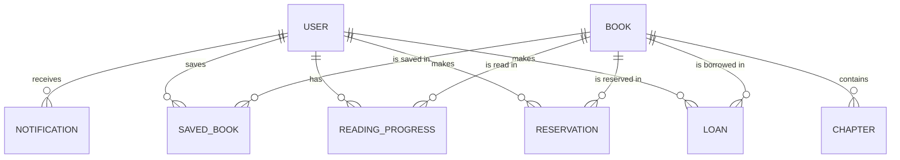

# Database Design — Bookmate

| Version | Date | Author | Change |
|---|---|---|---|
| 1.0 | 2026-11 | Project team | First version |

## 1. Purpose
This document defines how Bookmate stores data in Cloud Firestore (see System Architecture, AD-03): collections, fields, relationships, rules, indexes, and the plan for loading book data. It covers all entities of SRS section 3.4.

## 2. Entity Relationships



## 3. Collections

| Firestore path | Entity | Why this place |
|---|---|---|
| `users/{uid}` | User | `uid` is the Firebase Authentication user ID |
| `users/{uid}/readingProgress/{bookId}` | ReadingProgress | Private to the user, easy rules |
| `users/{uid}/savedBooks/{bookId}` | SavedBook | Private to the user |
| `users/{uid}/notifications/{id}` | Notification | Private to the user |
| `books/{bookId}` | Book | Shared catalog |
| `books/{bookId}/chapters/{chapterNo}` | Chapter | Loaded only when a book is read or summarized |
| `loans/{loanId}` | Loan | Top level so the Admin can list all active loans (FR-34) |
| `reservations/{id}` | Reservation | Top level so the Admin can find the waiting list of a book |

## 4. Data Dictionary

### 4.1 `users/{uid}`
| Field | Type | Description |
|---|---|---|
| name | string | Full name |
| email | string | Email |
| role | string | `member` or `admin`. Set to `member` at registration; Admin accounts are changed by the team (SRS A-05) |
| favoriteGenres | array of string | Chosen in onboarding (FR-43) and profile (FR-03) |
| onboardingDone | boolean | True after onboarding |
| activeLoanCount | number | Number of active loans; used for the borrow limit |
| createdAt | timestamp | Registration time |

### 4.2 `books/{bookId}`
| Field | Type | Description |
|---|---|---|
| title, author | string | Book title and author |
| isbn | string | ISBN (digits only) |
| genre | string | One main genre |
| description | string | Short description |
| coverUrl | string (optional) | Cover image address; if empty the app shows a color block |
| totalCopies | number | All copies |
| availableCopies | number | Copies on the shelf now |
| hasFullText | boolean | True if chapters exist (public-domain book) |
| chapterCount | number | Number of chapters (0 if no full text) |
| bookSummary | string (optional) | Stored AI summary of the whole book, checked by a team member |
| searchKeywords | array of string | Lowercase words of title and author, for search |
| createdAt, updatedAt | timestamp | Record times |

### 4.3 `books/{bookId}/chapters/{chapterNo}`
| Field | Type | Description |
|---|---|---|
| number | number | Chapter number (also the document ID) |
| title | string | Chapter title |
| paragraphs | array of string | Chapter text split into paragraphs |
| summary | string (optional) | Stored AI summary of the chapter, checked by a team member |


### 4.4 `loans/{loanId}`
| Field | Type | Description |
|---|---|---|
| userId | string | Borrower |
| bookId, bookTitle | string | Book (title copied for fast lists) |
| borrowDate, dueDate | timestamp | Dates |
| returnDate | timestamp (optional) | Set when returned |
| renewalCount | number | Number of renewals (0 or 1) |
| status | string | `active` or `returned` (overdue is calculated from `dueDate`) |

### 4.5 `reservations/{id}`
| Field | Type | Description |
|---|---|---|
| userId, bookId, bookTitle | string | Who and which book |
| createdAt | timestamp | Order in the waiting list |
| status | string | `waiting`, `ready`, `cancelled`, or `fulfilled` |

### 4.6 `users/{uid}/readingProgress/{bookId}`
| Field | Type | Description |
|---|---|---|
| chapter | number | Current chapter |
| paragraph | number | Index of the paragraph where the reader stopped (it does not change when the text size changes) |
| finished | boolean | Marked as finished (FR-45) |
| finishedAt | timestamp (optional) | Date finished |
| updatedAt | timestamp | Last read time |

### 4.7 `users/{uid}/savedBooks/{bookId}`
| Field | Type | Description |
|---|---|---|
| bookTitle | string | Title for the list |
| savedAt | timestamp | When saved |

### 4.8 `users/{uid}/notifications/{id}`
| Field | Type | Description |
|---|---|---|
| type | string | `due_soon`, `overdue`, or `reservation_ready` |
| message | string | Text shown |
| bookId | string | Related book |
| createdAt | timestamp | Time |
| read | boolean | Opened by the user |

AI chat messages are **not stored**. They exist only while the chat screen is open (NFR-08).

## 5. Main Operations

| Operation | Steps (one Firestore transaction unless noted) |
|---|---|
| Borrow (FR-11, FR-18) | Before the transaction: check no overdue loan. In the transaction: book `availableCopies` > 0 and user `activeLoanCount` < 3; create the loan; `availableCopies` − 1; `activeLoanCount` + 1. |
| Renew (FR-15) | Loan is `active` and `renewalCount` is 0: move `dueDate` forward and set `renewalCount` to 1. |
| Reserve (FR-12) | Only when `availableCopies` is 0 and the user has no active loan or waiting reservation for this book. Create the reservation with `waiting`. |
| Cancel reservation (FR-13) | Set status to `cancelled`. |
| Record return (FR-33), by Admin | Set loan `returned` and `returnDate`; `availableCopies` + 1; user `activeLoanCount` − 1; if a waiting reservation exists, set the oldest one to `ready` and create a `reservation_ready` notification for that user. |
| Search (FR-06, FR-07) | The catalog is small, so the app loads the book list and filters on the device; ISBN search uses an exact match. `searchKeywords` allows a query-based search if the catalog grows. |
| Save reading position (FR-37) | Write `chapter` and `paragraph` to `readingProgress` when the user leaves the Reader or changes chapter. |
| Due reminders (FR-17) | The device creates `due_soon` and `overdue` notifications from the user's own loans (WorkManager); Members may create notifications in their own space. |

**Design assumptions**
| ID | Assumption |
|---|---|
| DA-01 | A Member may have at most 3 active loans. |
| DA-02 | A renewal adds the same loan period as the first loan (14 days, SRS A-01). |
| DA-03 | The queue position of a reservation is not shown to the Member (privacy, NFR-07). |
| DA-04 | The overdue check before borrowing is done outside the transaction (Firestore transactions cannot run queries). A tiny risk of a race is accepted for the demo. |

## 6. Security Rules
The rules enforce NFR-07. They are written here as the design and are tested with the Firebase emulator during Implementation.

```
rules_version = '2';
service cloud.firestore {
  match /databases/{database}/documents {

    function signedIn() { return request.auth != null; }
    function isOwner(uid) { return signedIn() && request.auth.uid == uid; }
    function isAdmin() {
      return signedIn() &&
        get(/databases/$(database)/documents/users/$(request.auth.uid)).data.role == 'admin';
    }


    match /users/{uid} {
      allow read: if isOwner(uid) || isAdmin();
      allow create: if isOwner(uid)
        && request.resource.data.role == 'member'
        && request.resource.data.activeLoanCount == 0;
      allow update: if (isOwner(uid) && request.resource.data.diff(resource.data)
          .affectedKeys().hasOnly(['name', 'favoriteGenres', 'onboardingDone', 'activeLoanCount']))
        || (isAdmin() && request.resource.data.diff(resource.data)
          .affectedKeys().hasOnly(['activeLoanCount']));
      allow delete: if false;

      match /readingProgress/{bookId} { allow read, write: if isOwner(uid); }
      match /savedBooks/{bookId}      { allow read, write: if isOwner(uid); }
      match /notifications/{id} {
        allow read: if isOwner(uid);
        allow create: if isOwner(uid) || isAdmin();
        allow update: if isOwner(uid) && request.resource.data.diff(resource.data)
          .affectedKeys().hasOnly(['read']);
        allow delete: if isOwner(uid);
      }
    }

    match /books/{bookId} {
      allow read: if signedIn();
      allow create, delete: if isAdmin();
      allow update: if isAdmin()
        || (signedIn() && resource.data.availableCopies > 0
            && request.resource.data.diff(resource.data).affectedKeys().hasOnly(['availableCopies'])
            && request.resource.data.availableCopies == resource.data.availableCopies - 1);
      match /chapters/{chapterNo} {
        allow read: if signedIn();
        allow write: if isAdmin();
      }
    }

    match /loans/{loanId} {
      allow read: if signedIn() && (resource.data.userId == request.auth.uid || isAdmin());
      allow create: if signedIn() && request.resource.data.userId == request.auth.uid
        && request.resource.data.status == 'active'
        && request.resource.data.renewalCount == 0;
      allow update: if isAdmin()
        || (signedIn() && resource.data.userId == request.auth.uid
            && resource.data.status == 'active'
            && request.resource.data.diff(resource.data).affectedKeys().hasOnly(['dueDate', 'renewalCount'])
            && request.resource.data.renewalCount == resource.data.renewalCount + 1
            && request.resource.data.renewalCount <= 1);
      allow delete: if false;
    }

    match /reservations/{id} {
      allow read: if signedIn() && (resource.data.userId == request.auth.uid || isAdmin());
      allow create: if signedIn() && request.resource.data.userId == request.auth.uid
        && request.resource.data.status == 'waiting';
      allow update: if isAdmin()
        || (signedIn() && resource.data.userId == request.auth.uid
            && request.resource.data.status == 'cancelled');
      allow delete: if false;
    }
  }
}
```

**Limits of these rules (known and accepted for the demo)**
- Rules cannot count a user's loans, so the limit of 3 loans is enforced in the app and in the transaction, not by the rules alone. A Member who changes their own app could bypass it.
- A Member can only decrease `availableCopies` by 1; the rules cannot check that a loan was created in the same step. Only an Admin can increase copies (on return).
- Role changes are blocked for users; only the team changes a role in the Firebase console.

## 7. Indexes
Composite indexes needed by the queries (Firestore shows the exact link when a query needs one):

| Collection | Fields | Used for |
|---|---|---|
| loans | userId, status, dueDate | My Books (FR-14) |
| loans | status, dueDate | Admin active loans (FR-34) |
| reservations | userId, status, createdAt | My Books (FR-14) |
| reservations | bookId, status, createdAt | Oldest waiting reservation on return (FR-33) |
| books | genre, title | Browse by genre (FR-07) |


## 8. Loading Book Data (seed plan)
- The team prepares the data once with a small script kept in the repository (`Implementation/tools/seed/`). It reads the prepared files and writes them to Firestore.
- **Books with full text:** 5 to 10 public-domain books (SRS A-03). The text is split into chapters and paragraphs (see AI Integration Design). Stored summaries are added after a team member checks them.
- **Catalog-only books:** a few more books with title, author, genre, and description only (`hasFullText` false), so the library looks realistic and FR-29 can be tested.
- **Accounts:** one Admin account and two or three Member accounts with sample data for testing.
- No personal data of real people is loaded.

## 9. Size and Cost Notes
- One chapter is one document, far below the Firestore document size limit.
- Reading a chapter reads one document; search reads the small catalog once per session. This keeps usage low for the free tier (to be confirmed, see System Architecture section 9).

## 10. Requirement Coverage

| Requirements | Data used |
|---|---|
| FR-01 to FR-05 | `users` |
| FR-06 to FR-10 | `books` |
| FR-11 to FR-18 | `loans`, `reservations`, `books`, `users.activeLoanCount` |
| FR-19, FR-20, FR-35 | `books` (and the web book APIs) |
| FR-21 to FR-23 | `users.favoriteGenres`, `loans`, `books` |
| FR-24 to FR-30 | `books`, `chapters` (text and stored summaries) |
| FR-31 to FR-34 | `books`, `loans`, `reservations` |
| FR-36 to FR-41 | `chapters`, `readingProgress` |
| FR-42, FR-45 | `readingProgress` |
| FR-43, FR-46 | `users` |
| FR-44 | `savedBooks` |
| FR-47 | `notifications` |
| NFR-07, NFR-08 | Security rules, no storage of AI chat |
