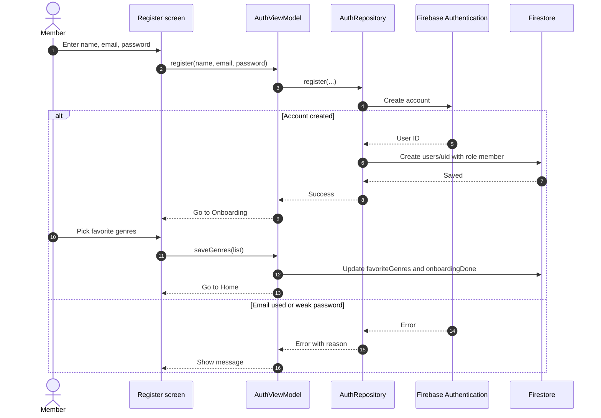
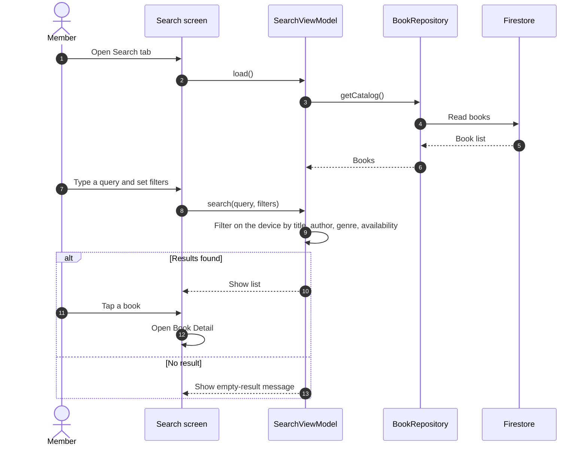
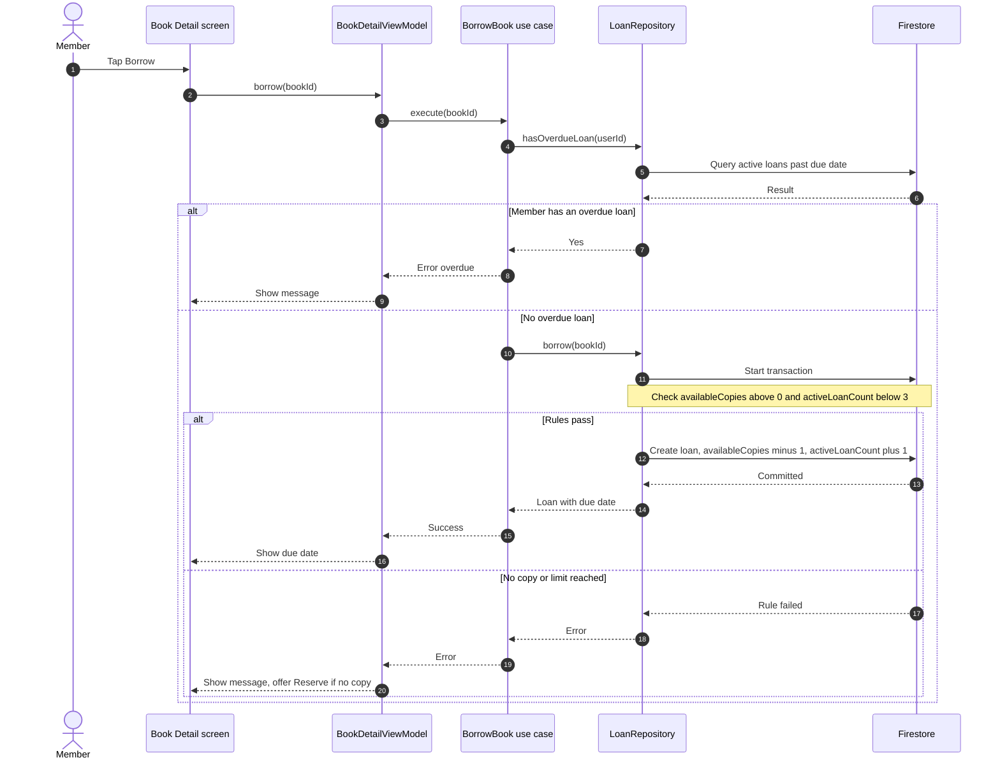
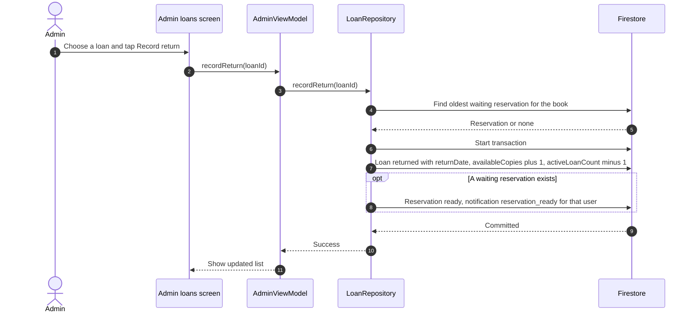
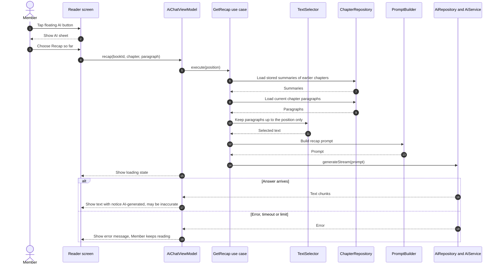
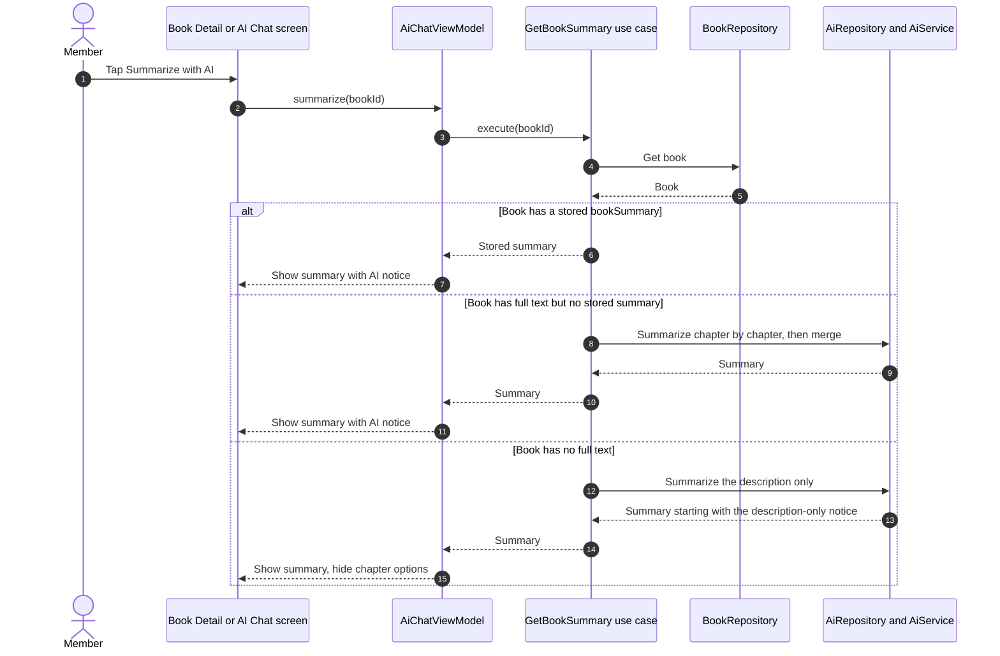
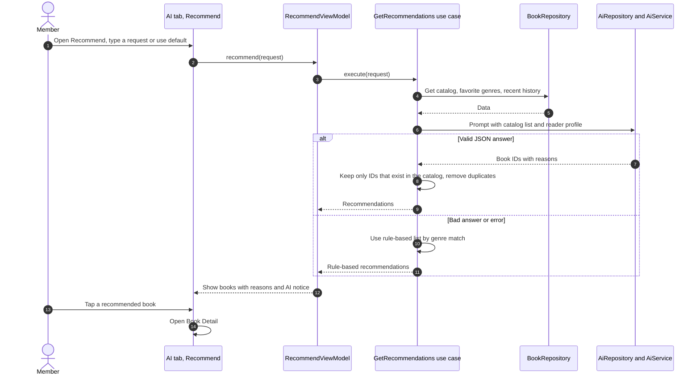
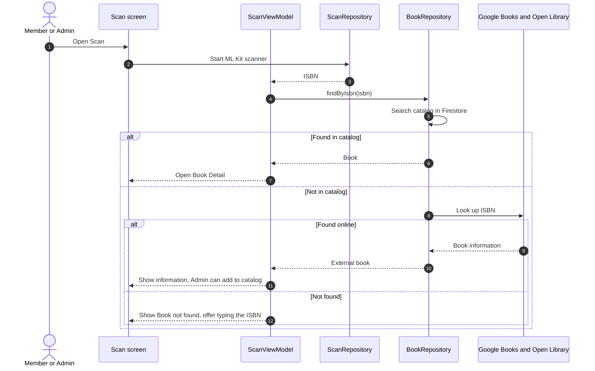

# Sequence Diagrams — Bookmate

| Version | Date | Author | Change |
|---|---|---|---|
| 1.0 | 2026-11 | Project team | First version |

## 1. Purpose
These diagrams show how the parts of Bookmate work together for the main use cases of the SRS. They follow the System Architecture (layers and components), the Database Design (transactions and collections), and the AI Integration Design (text selection, stored summaries, error handling). They are the guide for writing the code and the test cases.

GitHub shows the diagrams automatically. If a viewer does not, paste the diagram text into the Mermaid Live Editor (mermaid.live).

## 2. Diagram List

| Diagram | Use case | Requirements |
|---|---|---|
| 3.1 Register and onboarding | UC-01 | FR-01, FR-43 |
| 3.2 Search and open a book | UC-02 | FR-06, FR-07, FR-09, FR-10 |
| 3.3 Borrow a book | UC-03 | FR-11, FR-18 |
| 3.4 Reserve a book | UC-04 | FR-12 |
| 3.5 Record a return (Admin) | UC-09 | FR-33 |
| 3.6 AI help while reading (Recap so far) | UC-10 | FR-38 to FR-41, FR-28, FR-30 |
| 3.7 AI book summary | UC-05 | FR-24, FR-29 |
| 3.8 AI recommendation | UC-06 | FR-21 to FR-23 |
| 3.9 Scan an ISBN | UC-07 | FR-19, FR-20, FR-35 |

Not drawn: login and logout, saved books, settings, notifications, and Admin add or edit book (UC-08). They are simple one-step actions on one collection, described in the Database Design.

## 3. Diagrams

### 3.1 Register and onboarding (UC-01)

### 3.2 Search and open a book (UC-02)

### 3.3 Borrow a book (UC-03)

### 3.4 Reserve a book (UC-04)

```mermaid
sequenceDiagram
  autonumber
  actor M as Member
  participant S as Book Detail screen
  participant VM as BookDetailViewModel
  participant LR as LoanRepository
  participant FS as Firestore
  M->>S: Tap Reserve
  S->>VM: reserve(bookId)
  VM->>LR: reserve(bookId)
  LR->>FS: Read the book and check no active loan and no waiting reservation for it
  FS-->>LR: Result
  alt Book has no available copy
    LR->>FS: Create reservation with status waiting
    FS-->>LR: Saved
    LR-->>VM: Success
    VM-->>S: Show You are in the queue
  else Copy is available now
    LR-->>VM: Error use Borrow instead
    VM-->>S: Show message
  end
```

### 3.5 Record a return, by Admin (UC-09)

### 3.6 AI help while reading: Recap so far (UC-10)

### 3.7 AI book summary (UC-05)

### 3.8 AI recommendation (UC-06)

### 3.9 Scan an ISBN (UC-07)

## 4. Notes for Implementation
- Every ViewModel call ends in a `UiState` of Success or Error, so each diagram's error branch becomes an error message on screen (FR-30, NFR-04).
- Diagram 3.3 and 3.5 are the two Firestore transactions of the project; their test cases must cover the failure branch.
- Diagram 3.6 is the most important AI test: the text sent must never include paragraphs after the reader's position (FR-41).
