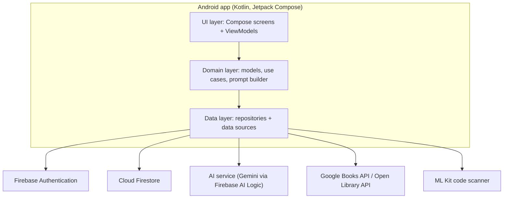

# System Architecture — Bookmate

| Version | Date | Author | Change |
|---|---|---|---|
| 1.0 | 2026-11 | Project team | First version |

## 1. Purpose
This document describes how Bookmate is built: the layers, the main components, the technologies, and how data and AI requests flow. It answers the points the SRS left for the Design phase (data storage, authentication, minimum Android version).

## 2. Architecture Overview

Bookmate is a single Android app (one Gradle module, `app`) that follows **MVVM** with three layers. It uses Firebase for accounts and data, and a few public web services for book information.

**Layers**

| Layer | Package | Responsibility |
|---|---|---|
| UI | `com.bookmate.app.ui` | Compose screens and ViewModels. Shows state, sends user actions. No business rules, no network calls. |
| Domain | `com.bookmate.app.domain` | Models (Book, Loan, Chapter...), use cases (for example BorrowBook, GetChapterSummary), and the PromptBuilder. Pure Kotlin. |
| Data | `com.bookmate.app.data` | Repositories and data sources (Firestore, book APIs, AI service, scanner, settings). Hides where data comes from. |
| Util | `com.bookmate.app.util` | Small helpers (date, text, result types). |

The package names follow the Project Standards.

## 3. Architecture Decisions

| ID | Decision | Reason | Alternative not chosen |
|---|---|---|---|
| AD-01 | MVVM with one-way data flow: a ViewModel holds a `UiState` (Loading, Success, Error) exposed as `StateFlow`; screens only show it. | Standard for Compose, easy to test, gives loading and error states for every screen (FR-30, NFR-04). | MVI (more code for a small team) |
| AD-02 | Firebase Authentication (email and password) for accounts. | No own server, passwords handled by a trusted service (NFR-05). | Own login server (time) |
| AD-03 | Cloud Firestore for users, books, loans, reservations, saved books, reading progress, notifications, and chapter text. | Works without a server, free tier is expected to be enough for the demo, simple to seed with data. | Own backend with SQL (time and hosting) |
| AD-04 | No Cloud Functions. Borrow and return use a Firestore transaction that writes the loan and changes available copies together. | Avoids a paid plan and extra code. | Server-side logic |
| AD-05 | AI requests go through **Firebase AI Logic** (Gemini) behind an `AiService` interface. No AI key is stored in the app or the repository. | Meets NFR-06. The interface keeps the provider in one place so it can be swapped (NFR-12, risk R-02). | Direct Gemini API key inside the app (key can be extracted from the APK) |
| AD-06 | Public-domain chapter text is prepared once by the team and stored in Firestore. The app does not call Project Gutenberg at runtime. | No runtime dependency, clean chapters, legal text only (NFR-10). | Download text when the user opens a book |
| AD-07 | Book information for search and ISBN lookup comes from Google Books API and Open Library API through Retrofit. The library catalog in Firestore is the main source; the web APIs fill missing data (FR-20, FR-35). | Two sources reduce missing data (risk R-09). | One source only |
| AD-08 | ML Kit code scanner (Google Play services) for ISBN scan. | Ready-made scanner screen, less code than building a camera screen. | CameraX with custom scanner |
| AD-09 | Hilt for dependency injection. | Common in Compose projects; ViewModels get repositories easily. | Manual injection |
| AD-10 | Jetpack DataStore for settings (text size, reminders on or off). WorkManager for due-date reminders (FR-17). | Small, standard tools. | SharedPreferences, AlarmManager |
| AD-11 | Minimum Android version: **Android 8.0 (API 26)**. Target: the latest stable version when the project is created. | Closes the SRS point NFR-11; all chosen libraries support it. | Lower versions (extra work for little gain) |
| AD-12 | No offline mode (out of scope in the SRS). Only a short in-memory cache of the last results. | Saves time. | Room database cache |

## 4. Technology Stack

| Area | Technology |
|---|---|
| Language and IDE | Kotlin, Android Studio, Gradle (Kotlin DSL, version catalog) |
| UI | Jetpack Compose, Material Design 3, Navigation Compose, Coil (images) |
| State | ViewModel, StateFlow, Kotlin Coroutines |
| Dependency injection | Hilt |
| Accounts and data | Firebase Authentication, Cloud Firestore |
| AI | Gemini through Firebase AI Logic |
| Book web data | Retrofit, OkHttp, Kotlin serialization (Google Books API, Open Library API) |
| Scan | ML Kit code scanner |
| Settings and reminders | DataStore, WorkManager |
| Testing | JUnit and a mocking library for unit tests; Compose UI tests for key flows |

Library versions are chosen when the Android project is created, using the current stable releases.

## 5. Main Components

| Feature | Screens (UI Design) | ViewModel | Repository | Data source |
|---|---|---|---|---|
| Account and profile | SCR-01, 02, 03, 11, 13 | AuthViewModel, ProfileViewModel | AuthRepository, UserRepository | Firebase Authentication, Firestore, DataStore |
| Catalog and search | SCR-04, 05, 06 | HomeViewModel, SearchViewModel, BookDetailViewModel | BookRepository | Firestore, Google Books and Open Library |
| Borrowing | SCR-06, 10 | LoansViewModel | LoanRepository | Firestore (transaction) |
| Saved and finished | SCR-12 | LibraryListsViewModel | ReadingRepository | Firestore |
| Reader and progress | SCR-07 | ReaderViewModel | ReadingRepository, ChapterRepository | Firestore |
| AI chat and Reader AI | SCR-08, 09 | AiChatViewModel | AiRepository | AiService (Firebase AI Logic) |
| AI recommendation | SCR-04, AI tab | RecommendViewModel | AiRepository, BookRepository | AiService, Firestore |
| ISBN scan | SCR-14 | ScanViewModel | ScanRepository, BookRepository | ML Kit, book APIs |
| Admin | SCR-15 | AdminViewModel | BookRepository, LoanRepository | Firestore, book APIs |

## 6. Data Flows

**Borrow a book (UC-03)**
1. The Book Detail screen sends "borrow" to BookDetailViewModel.
2. The BorrowBook use case checks the rules (copy available, no overdue loan, borrow limit).
3. LoanRepository runs one Firestore transaction: create the loan with its due date and reduce available copies by 1.
4. The ViewModel shows Success (due date) or Error (message).

**AI help while reading (UC-10)**
1. The Reader sends the user's choice (for example "Recap so far") and the current position (chapter, position) to AiChatViewModel.
2. ChapterRepository loads the chapter text. For "Recap so far", only text up to the position is used (FR-41).
3. PromptBuilder creates the prompt: the task, the text, and the rule "use only the given text".
4. AiRepository calls AiService. The screen shows a loading state meanwhile (FR-30).
5. The answer is shown with the notice "AI-generated, may be inaccurate" (FR-28).
The detailed chunking and prompt design are in the AI Integration Design document.

## 7. Security Design (NFR-05 to NFR-08)
- Passwords are handled only by Firebase Authentication.
- Each user has a role field (`member` or `admin`) in their Firestore user record. Admin accounts are created by the team (SRS assumption A-05).
- **Firestore security rules** enforce the roles: a Member can read books and read and write only their own loans, reservations, saved books, progress, and notifications; only an Admin can add, edit, or remove books. A Member may change a book's available copies only by 1 and only together with their own loan. The rules are defined in the Database Design.
- No AI key is stored in the app (AD-05). The Firebase configuration file (`google-services.json`) is kept out of the public repository and shared inside the team.
- Test data uses sample accounts only.

## 8. How the Architecture Meets the Non-Functional Requirements

| NFR | How |
|---|---|
| NFR-01 Usability | Material 3 components and the UI Design style guide |
| NFR-02 Search speed | Firestore queries with indexes; results shown as they load; short cache of the last results |
| NFR-03 AI speed | Loading state at once; only the needed chapter text is sent, not the whole book |
| NFR-04 Reliability | `UiState` Error for every request; no crash on empty or failed responses |
| NFR-05 to NFR-07 Security | Firebase Authentication, role-based Firestore rules, no keys in the app |
| NFR-08 Privacy | Only name, email, and library data are stored |
| NFR-09 Transparency | AI notice added in one place (the AI answer component) so it cannot be forgotten |
| NFR-10 Legal | Chapter text exists only for public-domain books, seeded by the team |
| NFR-11 Compatibility | Android 8.0 (API 26) or higher |
| NFR-12 Maintainability | Layers, Hilt, and the `AiService` interface; Project Standards for style |
| NFR-13 Availability | A failure of the AI or book APIs affects only those features; the rest of the app works |
| NFR-14 Testability | ViewModels and use cases do not depend on Android classes, so they can be unit tested |

## 9. Checks Before Coding
These points depend on services outside our control and are checked at the start of Implementation (risk R-02):
1. Firebase AI Logic is available and its limits are enough on the plan the team uses.
2. The ML Kit code scanner works on the team's test phones.
3. Firestore free-tier limits are enough for the demo.

If check 1 fails, the AI provider is replaced behind `AiService` without changing the screens.
